# 🚀 FormCraft — Interactive Form Builder with Chatbot Widget

> **Full-Stack Web Application** that empowers creators and teams to design conversational forms, embed an interactive floating chatbot widget on any website, share unique public URLs, and manage live submissions through an intuitive dashboard.

[-black.svg?style=flat&logo=next.js)](https://nextjs.org/)
[](https://react.js.org/)
[](https://www.typescriptlang.org/)
[](https://supabase.com/)
[](https://tailwindcss.com/)
[](LICENSE)

---

## 🎯 Project Overview

Traditional static web forms suffer from high abandonment rates and disjointed user experiences. **FormCraft** addresses this by transforming conventional forms into dynamic, step-by-step conversational chatbot flows.

Respondents answer questions one by one in an engaging, humanized chat dialogue with instant feedback, while creators manage question logic and inspect response analytics within a clean dashboard.

### 🌟 Core Capabilities
- **Conversational Experience**: Chatbot interface presenting questions one at a time with typed inputs, interactive pills, and dynamic progress tracking.
- **Visual Split-Screen Builder**: Real-time side-by-side editing and mobile/chat preview with live validation.
- **Multiple Question Archetypes**: Short Text, Email (with RFC validation), Multiple Choice (custom option arrays), and Yes/No toggles.
- **Universal Embeddability**: Embed anywhere using an embed snippet, standalone iframe, or direct public share link (`/f/[formId]`).
- **Security & Multi-Tenancy**: Built with Supabase Auth, PostgreSQL, and Row Level Security (RLS) guaranteeing tenant isolation alongside secure anonymous submissions for published forms.
- **Solid Brand Aesthetics**: A tailored high-contrast Dark Green (`#166534`) and crisp white palette — strictly solid colors, clean borders, and accessible typography.

---

## 🏗️ System Architecture & Workflow

```
[ Form Creator / Admin ]
        │
        ├──► Supabase Auth (Sign Up / Sign In / Session Cookies)
        │
        ├──► FormCraft Dashboard (/dashboard)
        │         ├── Stats Overview (Total Forms, Submissions, Published/Drafts)
        │         ├── Form Manager (Create, Edit, Delete, Publish/Unpublish)
        │         └── Submissions Viewer (Question-to-Answer Relational Mapping)
        │
        └──► Split-Screen Form Builder (/dashboard/forms/[id]/edit)
                  │
                  ▼
          [ PostgreSQL DB (Supabase) ]
             ├── forms (UUID, user_id, title, status)
             ├── questions (UUID, form_id, type, options, order)
             └── submissions (UUID, form_id, answers JSONB, timestamp)
                  │
                  ▼
        [ Public / Embedded Endpoints ]
        ├── /f/[formId] (Standalone Responsive Chatbot Interface)
        ├── External Website Embed (Widget Script / Iframe)
        └── Live Interactive Demo (Landing Page Playground)
```

| Flow Component | Type | Description |
| :--- | :--- | :--- |
| **Authentication Flow** | Supabase Auth SSR | Cookie-based session validation using Next.js Middleware with automatic redirect protection. |
| **Form Builder Engine** | Client-Side State + Server Actions | Optimistic local state management with dynamic reordering, type switching, and server action persistence. |
| **Chatbot Runtime** | Reactive State Engine | Sequential conversational stepper handling typing simulations, input validation, and progressive completion. |
| **Submission Ingestion** | Database Transaction | Stores answer payloads directly mapped to question UUIDs with RLS public insertion policies. |
| **Submissions Analytics** | Relational Aggregator | Resolves dynamic JSON answer dictionaries against question schemas to present clean tabular reports. |

---

## 📸 Screenshots & Output Demos

### 1. Modern Landing Page & Live Interactive Demo
A high-converting landing page showcasing platform value propositions, workflows, and an interactive live chatbot demo embedded right on the hero.

<p align="center">
  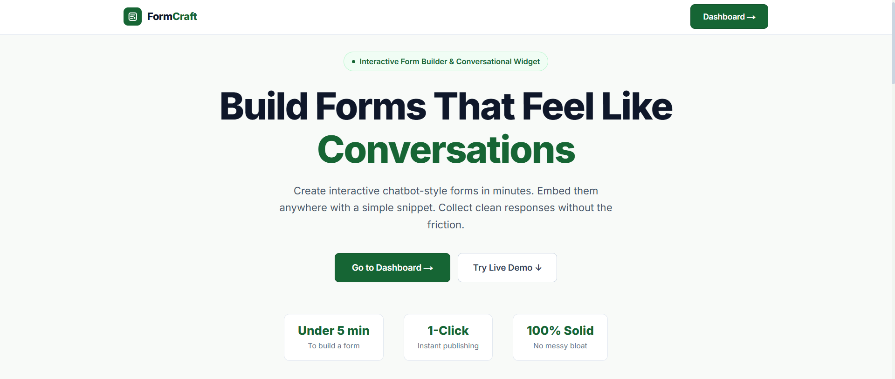
</p>

---

### 2. Live Chatbot Widget Playground
Users can test the conversational widget directly on the landing page before creating an account.

<p align="center">
  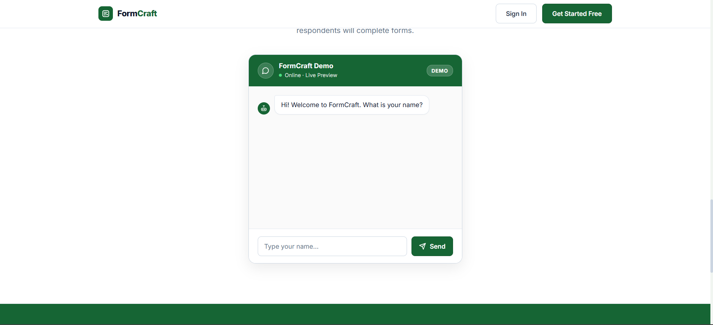
</p>

---

### 3. Authentication & Account Access
Secure email-and-password authentication powered by Supabase Auth with server-validated session cookies.

<p align="center">
  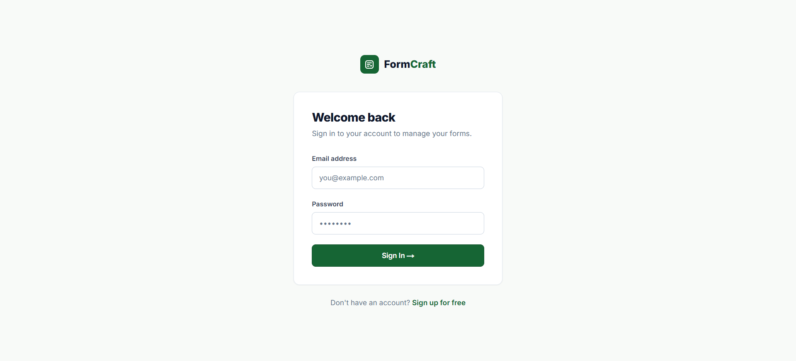
</p>

---

### 4. Creator Dashboard Overview
Comprehensive overview tracking active forms, published vs. draft statuses, total responses, and quick management links.

<p align="center">
  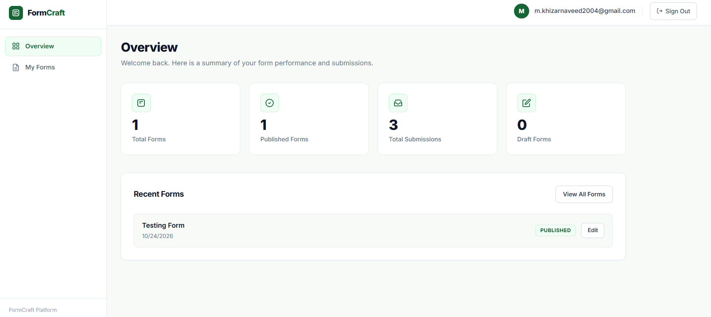
</p>

---

### 5. Forms Management Hub
Full list of created forms with status badges, timestamps, direct action menus (Edit, Embed, Submissions, Delete).

<p align="center">
  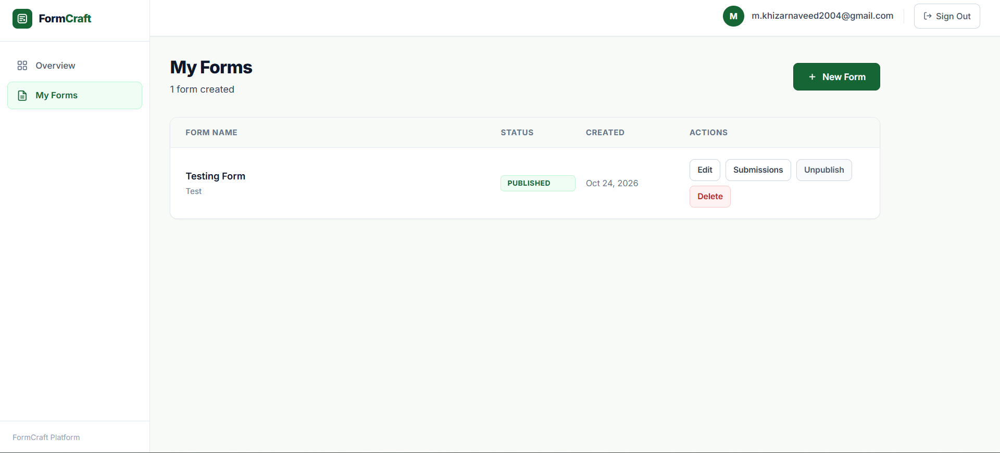
</p>

---

### 6. Interactive Split-Screen Form Builder
Real-time form creation studio supporting reordering, validation toggles, option editors, and immediate live chatbot preview.

<p align="center">
  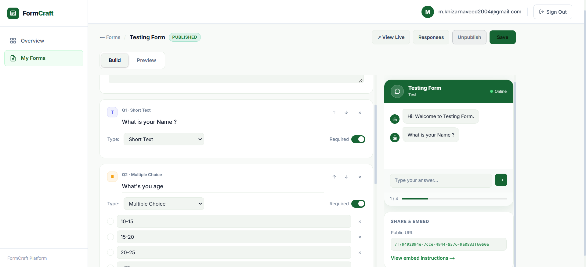
</p>

---

### 7. Cross-Profile & Public Submission Testing
Public forms accessible via `/f/[formId]` without requiring respondent login, tested across separate browsers and incognito profiles.

<p align="center">
  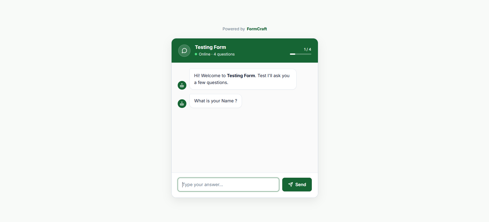
</p>

---

### 8. Real-Time Response Submissions
Submissions viewer displaying respondents' answers cleanly mapped to question labels with submission timestamps.

| Submission View 1 | Submission View 2 |
| :---: | :---: |
| 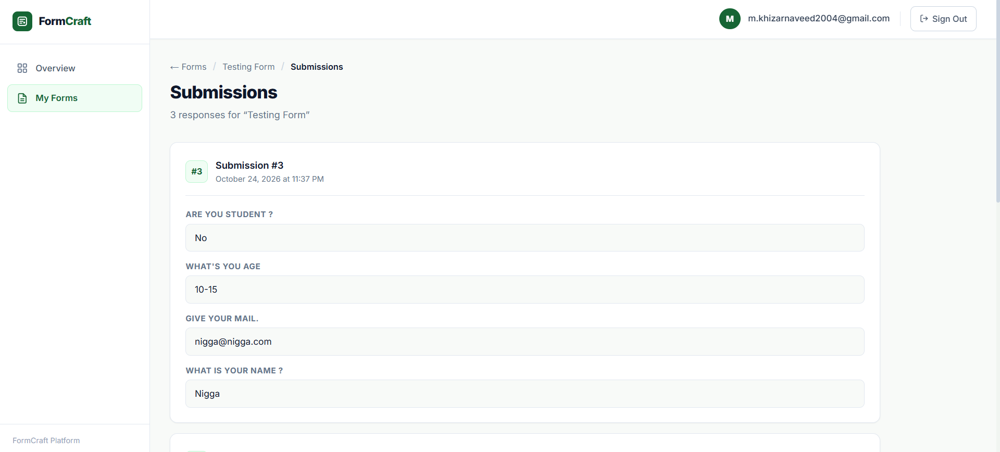 | 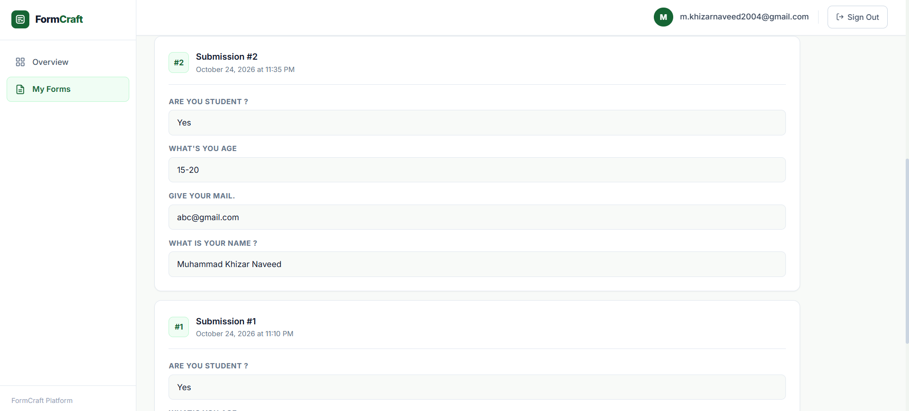 |

---

### 9. Database Architecture & Row Level Security
PostgreSQL schema in Supabase with RLS policies, indexed relational queries, and automated foreign key cascades.

| Relational Tables | Live Submissions Records |
| :---: | :---: |
| 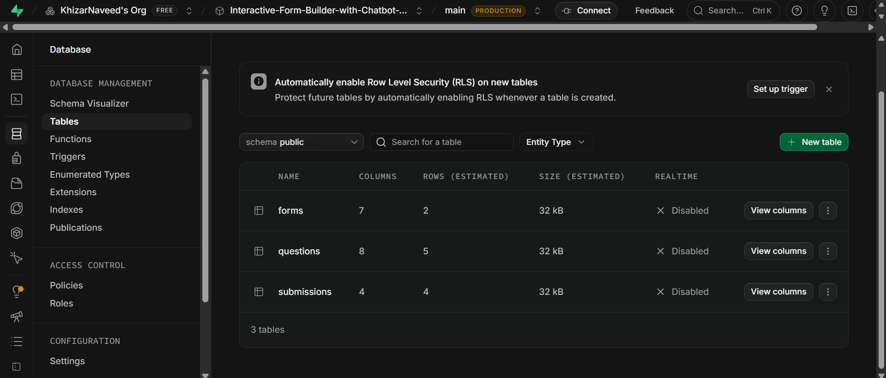 | 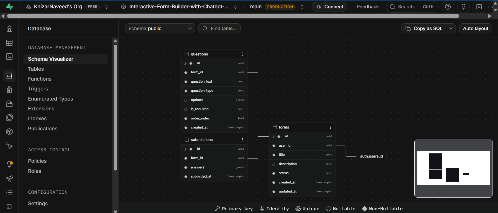 |

---

## 🛠️ Tech Stack & Implementation Details

| Layer | Technology | Rationale & Key Packages |
| :--- | :--- | :--- |
| **Framework** | **Next.js 14 (App Router)** | Fast server-side rendering, API Server Actions, streaming, and nested layouts. |
| **Language** | **TypeScript 5** | Strict type definitions for form schemas, question types, and database payloads. |
| **State & UI** | **React 18** | Split-screen optimistic state transitions, reactive chat loops, and hooks. |
| **Styling** | **Solid Green & White CSS System** | Clean solid palette (`#166534`), high-contrast typography, and zero gradient clutter. |
| **Database** | **Supabase (PostgreSQL)** | Relational data integrity, JSONB response storage, and foreign key cascades. |
| **Security & Auth** | **Supabase SSR + Next Middleware** | Cookie-based session tokens with Row Level Security (RLS) policies. |
| **Icons & Design** | **SVG Brand Logo & Lucide React** | Featherweight SVG icons with zero layout shift and brand-aligned favicon. |

---

## 📂 Project Directory Structure

```plaintext
Interactive-Form-Builder-with-Chatbot-Widget/
├── app/
│   ├── (auth)/                       # Authentication route group
│   │   ├── login/page.tsx            # Sign in page
│   │   └── signup/page.tsx           # Registration page
│   ├── dashboard/                    # Protected creator dashboard
│   │   ├── layout.tsx                # Dashboard shell with sidebar & header
│   │   ├── page.tsx                  # Metrics overview & quick actions
│   │   └── forms/
│   │       ├── page.tsx              # Form management list page
│   │       ├── FormsListClient.tsx   # Interactive client list with delete/publish
│   │       └── [id]/
│   │           ├── edit/             # Split-screen form builder
│   │           │   ├── page.tsx      # Server loader for questions & form
│   │           │   └── FormBuilderClient.tsx # Live builder & preview engine
│   │           ├── embed/            # Embed snippet generator (iframe / JS)
│   │           │   └── page.tsx      # Copyable snippets & code preview
│   │           └── submissions/      # Response viewer
│   │               └── page.tsx      # Submission logs & question mapping
│   ├── f/
│   │   └── [formId]/                 # Public standalone form runner
│   │       └── page.tsx              # Fullscreen chatbot runner for respondents
│   ├── actions.ts                    # Next.js Server Actions (CRUD, Submit, Toggle)
│   ├── globals.css                   # Solid Dark Green & White design system
│   ├── layout.tsx                    # Root layout with fonts, metadata, & favicon
│   └── page.tsx                      # Landing page with hero & embedded demo
├── components/
│   ├── Chatbot.tsx                   # Core conversational chatbot engine
│   ├── DashboardHeader.tsx           # Dashboard top navigation & user session
│   ├── DashboardSidebar.tsx          # Dashboard sidebar menu & active routes
│   ├── DemoChatbotClient.tsx         # Interactive demo runner for landing page
│   └── Icons.tsx                     # Brand logo & custom SVG UI elements
├── public/
│   └── favicon.svg                   # Brand tab icon (Dark green badge)
├── result/                           # Output screenshots and demonstration images
│   ├── Dashboard.png
│   ├── Database.png
│   ├── Database_Tables.png
│   ├── FormCraft_Demo.png
│   ├── Incognito.png
│   ├── Interface.png
│   ├── Making_Form.png
│   ├── MyForms.png
│   ├── SignIn.png
│   ├── Submission_1.png
│   └── Submission_2.png
├── types/
│   └── index.ts                      # Core TypeScript models (Form, Question, Submission)
├── utils/
│   └── supabase/                     # Supabase SSR client factories
│       ├── client.ts                 # Browser client (createBrowserClient)
│       ├── middleware.ts             # Session refresh & cookie updater
│       └── server.ts                 # Server component client (createServerClient)
├── middleware.ts                     # Next.js route protection & auth gate
├── package.json                      # Project dependencies & build scripts
├── tailwind.config.js                # Tailwind utility extensions
└── tsconfig.json                     # Strict TypeScript compiler configuration
```

---

## 🗄️ Database Schema & RLS Security

Run the following SQL migration script in your **Supabase SQL Editor** to initialize the complete database schema with security policies:

```sql
-- 1. Create Forms Table
CREATE TABLE IF NOT EXISTS forms (
  id UUID PRIMARY KEY DEFAULT gen_random_uuid(),
  user_id UUID NOT NULL REFERENCES auth.users(id) ON DELETE CASCADE,
  title TEXT NOT NULL DEFAULT 'Untitled Form',
  description TEXT DEFAULT '',
  status TEXT NOT NULL DEFAULT 'draft' CHECK (status IN ('draft', 'published')),
  created_at TIMESTAMPTZ DEFAULT NOW(),
  updated_at TIMESTAMPTZ DEFAULT NOW()
);

-- 2. Create Questions Table
CREATE TABLE IF NOT EXISTS questions (
  id UUID PRIMARY KEY DEFAULT gen_random_uuid(),
  form_id UUID NOT NULL REFERENCES forms(id) ON DELETE CASCADE,
  question_text TEXT NOT NULL,
  question_type TEXT NOT NULL CHECK (question_type IN ('text', 'email', 'multiple_choice', 'yes_no')),
  options JSONB DEFAULT '[]'::jsonb,
  is_required BOOLEAN DEFAULT true,
  order_index INTEGER NOT NULL DEFAULT 0,
  created_at TIMESTAMPTZ DEFAULT NOW()
);

-- 3. Create Submissions Table
CREATE TABLE IF NOT EXISTS submissions (
  id UUID PRIMARY KEY DEFAULT gen_random_uuid(),
  form_id UUID NOT NULL REFERENCES forms(id) ON DELETE CASCADE,
  answers JSONB NOT NULL DEFAULT '{}'::jsonb,
  submitted_at TIMESTAMPTZ DEFAULT NOW()
);

-- 4. Enable Row Level Security (RLS)
ALTER TABLE forms ENABLE ROW LEVEL SECURITY;
ALTER TABLE questions ENABLE ROW LEVEL SECURITY;
ALTER TABLE submissions ENABLE ROW LEVEL SECURITY;

-- 5. Security Policies for Forms
CREATE POLICY "Users can manage their own forms"
  ON forms FOR ALL
  TO authenticated
  USING (auth.uid() = user_id)
  WITH CHECK (auth.uid() = user_id);

CREATE POLICY "Public can view published forms"
  ON forms FOR SELECT
  TO public
  USING (status = 'published');

-- 6. Security Policies for Questions
CREATE POLICY "Users can manage questions of their own forms"
  ON questions FOR ALL
  TO authenticated
  USING (EXISTS (SELECT 1 FROM forms WHERE forms.id = questions.form_id AND forms.user_id = auth.uid()))
  WITH CHECK (EXISTS (SELECT 1 FROM forms WHERE forms.id = questions.form_id AND forms.user_id = auth.uid()));

CREATE POLICY "Public can view questions of published forms"
  ON questions FOR SELECT
  TO public
  USING (EXISTS (SELECT 1 FROM forms WHERE forms.id = questions.form_id AND forms.status = 'published'));

-- 7. Security Policies for Submissions
CREATE POLICY "Form owners can view their submissions"
  ON submissions FOR SELECT
  TO authenticated
  USING (EXISTS (SELECT 1 FROM forms WHERE forms.id = submissions.form_id AND forms.user_id = auth.uid()));

CREATE POLICY "Public can submit responses to published forms"
  ON submissions FOR INSERT
  TO public
  WITH CHECK (EXISTS (SELECT 1 FROM forms WHERE forms.id = submissions.form_id AND forms.status = 'published'));
```

---

## ⚡ Quickstart & Installation

### Prerequisites
- [Node.js](https://nodejs.org/) (v18.17.0 or later)
- [npm](https://www.npmjs.com/) or [yarn](https://yarnpkg.com/)
- A free [Supabase](https://supabase.com/) project

### 1. Clone the Repository
```bash
git clone https://github.com/KhizarNaveed/Interactive-Form-Builder-with-Chatbot-Widget.git
cd Interactive-Form-Builder-with-Chatbot-Widget
```

### 2. Install Project Dependencies
```bash
npm install
```

### 3. Configure Environment Variables
Create a `.env.local` file in the project root:
```env
NEXT_PUBLIC_SUPABASE_URL=https://your-project-id.supabase.co
NEXT_PUBLIC_SUPABASE_ANON_KEY=your-anon-key-here
```

### 4. Apply Database Migrations
Copy the SQL commands from the [Database Schema section](#️-database-schema--rls-security) and execute them inside your Supabase SQL Editor.

### 5. Launch the Local Development Server
```bash
npm run dev
```
Open **[http://localhost:3000](http://localhost:3000)** in your browser to view the application.

---

## 🧪 Testing Walkthrough

Follow these steps to test the application end-to-end:

1. **Test Landing Page Demo**:
   - Navigate to `http://localhost:3000`.
   - Scroll to the interactive chatbot preview and complete the sample form.
2. **Account Creation**:
   - Click **Get Started Free** or navigate to `/signup`.
   - Create an account using email and password.
3. **Build a Form**:
   - On the `/dashboard`, click **Create New Form**.
   - Add questions for each supported type (*Short Text*, *Email*, *Multiple Choice*, *Yes/No*).
   - Test reordering questions and toggling the *Required* switch.
   - Observe the live phone simulator updating instantly on the right.
4. **Publish Form**:
   - Click **Save Form**, then toggle status to **Publish**.
5. **Simulate External Respondent**:
   - Open an Incognito window or different browser profile.
   - Navigate to the generated public link: `http://localhost:3000/f/<form-id>`.
   - Complete the form and submit.
6. **Verify Submissions**:
   - Switch back to the creator dashboard.
   - Go to **My Forms** ➔ **Submissions**.
   - Confirm responses are logged with timestamps and question titles.

---

## 🚀 Website Embed Options

Once a form is published, creators can embed it into any external web platform using three integration methods:

### Option A: Floating Chatbot Widget (JavaScript Snippet)
Add this snippet just before the closing `</body>` tag of any HTML website:
```html
<script 
  src="https://your-domain.com/widget.js" 
  data-form-id="YOUR_FORM_ID" 
  defer>
</script>
```

### Option B: Inline Responsive Iframe
Embed the form directly into blog posts, landing pages, or Notion documents:
```html
<iframe 
  src="https://your-domain.com/f/YOUR_FORM_ID" 
  width="100%" 
  height="650" 
  frameborder="0" 
  style="border-radius: 12px; box-shadow: 0 4px 20px rgba(0,0,0,0.08);">
</iframe>
```

### Option C: Direct Public Link
Share the hosted URL directly on social media, newsletters, or emails:
```
https://your-domain.com/f/YOUR_FORM_ID
```

---

## 🤝 Contributing

Contributions, issues, and feature requests are welcome!

1. Fork the repository
2. Create your feature branch (`git checkout -b feature/AmazingFeature`)
3. Commit your changes (`git commit -m 'Add some AmazingFeature'`)
4. Push to the branch (`git push origin feature/AmazingFeature`)
5. Open a Pull Request

---

## 📄 License

This project is licensed under the **MIT License** — see the [LICENSE](LICENSE) file for details.

---

## 📬 Connect with Me

- **LinkedIn**: [Muhammad Khizar Naveed](https://www.linkedin.com/in/muhammad-khizar-naveed-0a8a61250/)
- **GitHub**: [KhizarNaveed](https://github.com/KhizarNaveed)
- **Email**: [m.khizarnaveed2004@gmail.com](mailto:m.khizarnaveed2004@gmail.com)

---

## 🙏 Acknowledgments

- **Tynoc-Tech**: For the internship opportunity, mentorship, and project requirements.
- **Supabase**: For providing reliable PostgreSQL, Row Level Security, and authentication infrastructure.
- **Next.js & Vercel**: For modern App Router capabilities and developer ecosystem.

---

⭐ **If you found this project useful, please consider giving it a star!**
