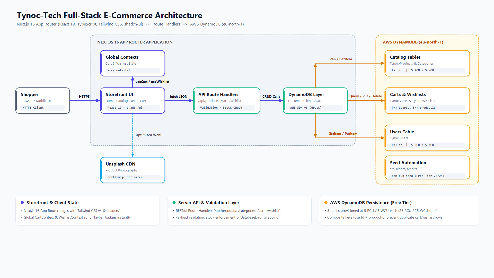

# 🛍️ Tynoc-Tech: Production-Ready E-Commerce Application

> **Full-Stack E-Commerce Platform** engineered with **Next.js (App Router)**, **TypeScript**, **Tailwind CSS**, **shadcn/ui**, and **AWS DynamoDB** — featuring a design-led storefront, real-time category & search filtering, persistent shopping cart & wishlist management, and a Free-Tier-optimized cloud database layer.

[-black.svg?style=flat&logo=next.js)](https://nextjs.org/)
[](https://react.dev/)
[](https://www.typescriptlang.org/)
[](https://tailwindcss.com/)
[](https://ui.shadcn.com/)
[-FF9900.svg?style=flat&logo=amazondynamodb)](https://aws.amazon.com/dynamodb/)
[](LICENSE)

---

## 🎯 Project Overview

Developed as a **Software Engineer Intern** capstone project for **Tynoc-Tech**, this application demonstrates a complete production software engineering workflow — from cloud database schema design and server-side API validation to global client state management and a high-craft storefront user experience.

Rather than building a static storefront template, **Tynoc Store** implements a layered full-stack architecture where every user interaction — browsing products, filtering by category or keyword, adjusting cart quantities, and saving items to a wishlist — is persisted in **AWS DynamoDB** through strongly typed Next.js Route Handlers.

### 🌟 Core Capabilities

- **Premium Storefront Experience**:
  - **Hero Showcase**: Soft mesh-gradient hero banner with bestseller spotlight, customer rating metrics, and quick collection links.
  - **Dynamic Product Catalog (`/products`)**: Instant keyword search, category filtering with live item counts, multi-mode sorting (*Featured*, *Price: Low to High*, *Price: High to Low*, *Name: A–Z*), loading skeletons, and empty-state recovery.
  - **Product Detail View (`/products/[id]`)**: High-resolution `next/image` gallery, real-time stock badges, SKU metadata, quantity selector with live subtotal preview, related products, and dedicated `404` product-not-found handling.
- **Persistent Shopping Cart (`/cart`)**:
  - Add items from any product card (*Quick Add* on hover) or product detail page.
  - Automatic duplicate merging (adding an existing cart item increments its quantity instead of creating duplicate rows).
  - Server-enforced stock validation preventing quantities above available inventory.
  - Real-time quantity increment/decrement, item removal, and order summary calculation (Subtotal, Free Express Shipping, Total).
- **Persistent Wishlist (`/wishlist`)**:
  - One-click heart toggle on product cards and detail pages with idempotent backend persistence.
  - Dedicated wishlist grid allowing shoppers to review saved items or move them directly to their cart.
- **RESTful API & AWS DynamoDB Layer**:
  - Clean separation between Next.js Route Handlers (`src/app/api/*`), generic `DocumentClient` CRUD helpers (`src/lib/dynamodb.ts`), and environment-validated AWS SDK initialization (`src/lib/db.ts`).
  - Automated idempotent database provisioning and seeding (`npm run seed`) configured specifically to stay within the **AWS Free Tier**.

---

## 🏗️ System Architecture & Workflow



> Interactive standalone diagram also available at [`docs/architecture.html`](docs/architecture.html).

```plaintext
[ Shopper (Desktop / Mobile Browser) ]
        │
        ▼
[ Next.js App Router Storefront (React 19 + Tailwind CSS + shadcn/ui) ]
  ├── Global Layout & Sticky Blur Navbar (Live Cart & Wishlist Badges)
  ├── Pages: Home (/), Catalog (/products), Detail (/products/[id]), Cart (/cart), Wishlist (/wishlist)
  └── Global State: CartContext & WishlistContext (src/context/*)
        │
        │  fetch() JSON (GET / POST / PUT / DELETE)
        ▼
[ Next.js API Route Handlers (src/app/api/*) ]
  ├── Request Validation & Stock Guards (src/lib/api.ts)
  ├── /api/products & /api/products/[id]
  ├── /api/categories
  ├── /api/cart
  └── /api/wishlist
        │
        │  DynamoDBDocumentClient Commands (Scan, Query, Get, Put, Update, Delete)
        ▼
[ Data Access Layer (src/lib/db.ts & src/lib/dynamodb.ts) ]
        │
        ▼
[ AWS DynamoDB (eu-north-1) — Provisioned 5 RCU / 5 WCU per table ]
  ├── Tynoc-Products    (PK: id)
  ├── Tynoc-Categories  (PK: id)
  ├── Tynoc-Users       (PK: id)
  ├── Tynoc-Carts       (PK: userId, SK: productId)
  └── Tynoc-Wishlists   (PK: userId, SK: productId)
```

| Architectural Layer | Key Modules | Responsibilities |
| :--- | :--- | :--- |
| **Presentation Layer** | `src/app/**`, `src/components/**` | Responsive UI built with `shadcn/ui` primitives (`Card`, `Button`, `Input`, `Badge`), `next/image` optimization, loading skeletons, and empty/404 states. |
| **Client State Layer** | `src/context/cart-context.tsx`, `src/context/wishlist-context.tsx` | Synchronizes cart items, subtotals, and wishlisted products with backend APIs and updates Navbar counters instantaneously. |
| **API / Controller Layer** | `src/app/api/**`, `src/lib/api.ts` | Validates JSON payloads and query parameters, enforces product stock limits, joins product metadata onto cart/wishlist items, and returns standardized HTTP status codes (`200`, `201`, `400`, `404`, `500`). |
| **Data Access Layer** | `src/lib/db.ts`, `src/lib/dynamodb.ts` | Fail-fast environment variable validation, singleton `DynamoDBDocumentClient`, and generic typed helpers (`putItem`, `getItem`, `updateItem`, `deleteItem`, `scanTable`, `queryByPartitionKey`) wrapped in `DatabaseError`. |
| **Cloud Persistence** | `src/scripts/seed.ts`, AWS DynamoDB | Provisions 5 tables in `eu-north-1` with composite keys (`userId` + `productId`) to prevent duplicate cart/wishlist entries at the storage engine level. |

---

## 🛠️ Tech Stack & Implementation Details

| Layer | Technology | Rationale & Key Packages |
| :--- | :--- | :--- |
| **Framework** | **Next.js 16.4 (App Router)** | Unified full-stack React framework providing nested layouts, Route Handlers, and Turbopack builds. |
| **Language** | **TypeScript 5 (`strict: true`)** | End-to-end type safety across domain entities (`Product`, `Category`, `User`, `CartItem`, `WishlistItem`), API payloads, and DynamoDB keys. |
| **UI & Styling** | **Tailwind CSS v4 + shadcn/ui** | High-contrast slate/indigo palette, warm `#fafafa` surface background, CVA component variants, and `lucide-react` icons. |
| **Database** | **AWS DynamoDB** | Managed NoSQL cloud database accessed via `@aws-sdk/client-dynamodb` and `@aws-sdk/lib-dynamodb` (AWS SDK v3). |
| **Image Pipeline** | **Next/Image + Unsplash CDN** | Automatic responsive WebP/AVIF resizing with graceful fallback placeholders (`ProductImage`). |
| **Tooling** | **ESLint 9 + `tsx`** | Strict React Hooks & TypeScript linting plus zero-config TypeScript execution for database seeding (`npm run seed`). |

---

## 📂 Project Directory Structure

```plaintext
Production-Ready E-Commerce Application/
├── docs/
│   ├── architecture.html             # Interactive standalone Archify architecture diagram
│   └── architecture.png              # Exported high-resolution architecture diagram image
├── public/                           # Static assets
├── src/
│   ├── app/
│   │   ├── api/                      # Next.js App Router Backend API Endpoints
│   │   │   ├── cart/
│   │   │   │   └── route.ts          # GET, POST, PUT, DELETE user cart items + subtotal
│   │   │   ├── categories/
│   │   │   │   └── route.ts          # GET all product categories
│   │   │   ├── products/
│   │   │   │   ├── route.ts          # GET products (with ?categoryId= & ?search= filters)
│   │   │   │   └── [id]/
│   │   │   │       └── route.ts      # GET single product by ID (404 if not found)
│   │   │   └── wishlist/
│   │   │       └── route.ts          # GET, POST, DELETE user wishlist items
│   │   ├── cart/
│   │   │   └── page.tsx              # Shopping Cart page with quantity controls & Order Summary
│   │   ├── products/
│   │   │   ├── page.tsx              # Product Catalog page with sidebar filters & search
│   │   │   └── [id]/
│   │   │       └── page.tsx          # Product Detail page with stock badge & related items
│   │   ├── wishlist/
│   │   │   └── page.tsx              # Saved Wishlist page
│   │   ├── globals.css               # Tailwind CSS v4 imports & theme variables
│   │   ├── layout.tsx                # Root layout wrapping CartProvider, WishlistProvider, Navbar & Footer
│   │   └── page.tsx                  # Storefront Homepage (Hero banner, Categories, Featured grid)
│   ├── components/
│   │   ├── ui/                       # shadcn/ui design system primitives
│   │   │   ├── badge.tsx
│   │   │   ├── button.tsx
│   │   │   ├── card.tsx
│   │   │   └── input.tsx
│   │   ├── footer.tsx                # Storefront footer & trust guarantees strip
│   │   ├── navbar.tsx                # Sticky backdrop-blur Navbar with live badges & search
│   │   ├── product-card.tsx          # Square product card with hover zoom, Quick Add & Wishlist toggle
│   │   └── product-image.tsx         # Resilient next/image wrapper with fallback UI
│   ├── context/
│   │   ├── cart-context.tsx          # Global Cart state & API mutation hooks
│   │   └── wishlist-context.tsx      # Global Wishlist state & toggle hooks
│   ├── lib/
│   │   ├── api.ts                    # ApiError, JSON body parser, input validators & error handler
│   │   ├── db.ts                     # DynamoDBClient, DocumentClient & TABLES registry
│   │   ├── dynamodb.ts               # Generic CRUD helpers (put, get, update, delete, scan, query)
│   │   └── utils.ts                  # Tailwind class merge helper (cn)
│   ├── scripts/
│   │   └── seed.ts                   # Idempotent DynamoDB table creator & initial data seeder
│   └── types/
│       └── index.ts                  # Core TypeScript interfaces (User, Category, Product, CartItem, WishlistItem)
├── .env.example                      # Safe template for required AWS environment variables
├── .gitignore                        # Excludes .env*, *.csv, memory-bank/, and build artifacts
├── next.config.ts                    # Next.js configuration (remotePatterns for Unsplash images)
├── package.json                      # Scripts & dependencies
└── tsconfig.json                     # Strict TypeScript configuration (@/* -> ./src/*)
```

---

## 🗄️ AWS DynamoDB Schema & Free-Tier Design

The application uses **5 DynamoDB tables** provisioned via `src/scripts/seed.ts`.

> **AWS Free Tier Optimization**: The AWS Free Tier provides **25 Read Capacity Units (RCU)** and **25 Write Capacity Units (WCU)** shared across the entire AWS account per region. Each of the 5 tables is explicitly provisioned with `ReadCapacityUnits: 5` and `WriteCapacityUnits: 5` (`BillingMode: "PROVISIONED"`), totaling **exactly 25 RCU and 25 WCU** so the deployment incurs zero DynamoDB capacity charges.

| Table Name | Partition Key (`HASH`) | Sort Key (`RANGE`) | Capacity | Purpose |
| :--- | :--- | :--- | :--- | :--- |
| `Tynoc-Products` | `id` (`String`) | — | 5 RCU / 5 WCU | Stores product catalog items (`name`, `description`, `price`, `categoryId`, `imageUrl`, `stock`). |
| `Tynoc-Categories` | `id` (`String`) | — | 5 RCU / 5 WCU | Stores storefront categories (*Electronics*, *Fashion*, *Home & Living*). |
| `Tynoc-Users` | `id` (`String`) | — | 5 RCU / 5 WCU | Stores user profiles (`id`, `name`, `email`, `createdAt`). |
| `Tynoc-Carts` | `userId` (`String`) | `productId` (`String`) | 5 RCU / 5 WCU | Stores per-user cart line items (`quantity`). Composite key prevents duplicate product rows per user. |
| `Tynoc-Wishlists` | `userId` (`String`) | `productId` (`String`) | 5 RCU / 5 WCU | Stores per-user saved wishlist items. Composite key guarantees idempotency. |

---

## 🔌 REST API Endpoints Reference

| Endpoint | Method | Query / Body Parameters | Description |
| :--- | :--- | :--- | :--- |
| `/api/products` | `GET` | Optional `?categoryId=...&search=...` | Returns all products, optionally filtered by category ID and/or case-insensitive keyword match. |
| `/api/products/[id]` | `GET` | Path param `id` | Returns a single product by ID, or `404` if not found. |
| `/api/categories` | `GET` | — | Returns all product categories. |
| `/api/cart` | `GET` | `?userId=test-user-123` | Queries user's cart items, hydrates each with full `Product` details, and calculates `lineTotal`, `itemCount`, and `subtotal`. |
| `/api/cart` | `POST` | `{ userId, productId, quantity }` | Adds item to cart (or increments quantity if already present) after verifying available stock. |
| `/api/cart` | `PUT` | `{ userId, productId, quantity }` | Updates an existing cart item's quantity after validating stock limits. |
| `/api/cart` | `DELETE` | `?userId=...&productId=...` | Removes an item from the user's cart. |
| `/api/wishlist` | `GET` | `?userId=test-user-123` | Queries user's wishlisted items hydrated with full `Product` details. |
| `/api/wishlist` | `POST` | `{ userId, productId }` | Saves a product to the user's wishlist (idempotent). |
| `/api/wishlist` | `DELETE` | `?userId=...&productId=...` | Removes a product from the user's wishlist. |

---

## ⚡ Quickstart & Installation

### Prerequisites
- [Node.js](https://nodejs.org/) (v18.18+ or v20+ recommended)
- [npm](https://www.npmjs.com/)
- An **AWS Account** with IAM credentials that have DynamoDB permissions (`AmazonDynamoDBFullAccess` or scoped table permissions)

### 1. Clone the Repository
```bash
git clone https://github.com/KhizarNaveed/Tynoc-Tech.git
cd "Tynoc-Tech/Production-Ready E-Commerce Application"
```

### 2. Install Dependencies
```bash
npm install
```

### 3. Configure Environment Variables
Copy `.env.example` to `.env.local` in the project root and populate your AWS credentials:
```bash
cp .env.example .env.local
```

```env
AWS_ACCESS_KEY_ID=your_access_key_id_here
AWS_SECRET_ACCESS_KEY=your_secret_access_key_here
AWS_REGION=eu-north-1
```

> 🔒 **Security Note**: `.env`, `.env.local`, and `*.csv` files are strictly excluded via `.gitignore` so credentials are never committed to version control.

### 4. Provision & Seed AWS DynamoDB
Run the seed script to create the 5 DynamoDB tables (if they don't already exist) and populate the 3 categories and 10 curated products:
```bash
npm run seed
```

### 5. Start the Development Server
```bash
npm run dev
```
Open **[http://localhost:3000](http://localhost:3000)** in your browser.

---

## 🚀 Deployment Notes

1. **Vercel / Cloud Hosting**:
   - Import the repository into [Vercel](https://vercel.com/) and set the **Root Directory** to `Production-Ready E-Commerce Application`.
   - Add `AWS_ACCESS_KEY_ID`, `AWS_SECRET_ACCESS_KEY`, and `AWS_REGION` (`eu-north-1`) in the project's Environment Variables settings.
2. **Production Build Verification**:
   ```bash
   npm run build
   npm start
   ```
3. **IAM Best Practices**:
   - In production, scope the IAM policy to the 5 `Tynoc-*` table ARNs (`dynamodb:GetItem`, `dynamodb:PutItem`, `dynamodb:UpdateItem`, `dynamodb:DeleteItem`, `dynamodb:Query`, `dynamodb:Scan`) rather than broad account-wide permissions.

---

## 📬 Connect with Me

- **LinkedIn**: [Muhammad Khizar Naveed](https://www.linkedin.com/in/muhammad-khizar-naveed-0a8a61250/)
- **GitHub**: [KhizarNaveed](https://github.com/KhizarNaveed)
- **Email**: [m.khizarnaveed2004@gmail.com](mailto:m.khizarnaveed2004@gmail.com)

---

## 🙏 Acknowledgments

- **Tynoc-Tech**: For the Software Engineer Internship opportunity, architectural guidance, and project specifications.
- **AWS DynamoDB & Next.js Teams**: For modern cloud persistence and full-stack React tooling.

---

⭐ **If you found this project useful, please consider giving the repository a star!**
